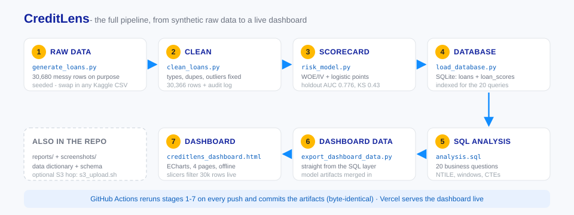

# CreditLens

**One end-to-end pipeline that proves SQL, Python, ML, cloud storage and dashboards on a single question: which bank loans default, and why?**

30,366 clean loan records → a WOE/logistic credit scorecard → SQLite → 20 business SQL queries → a 4-page interactive dashboard (plus Power BI-style screenshots). Every number below is real output of this repo — rerun the pipeline and you get the same numbers.

[](https://github.com/Vinayak-ux-g/CreditLens/actions/workflows/build.yml)
[](https://www.python.org)
[](LICENSE)

[](https://vercel.com/new/clone?repository-url=https%3A%2F%2Fgithub.com%2FVinayak-ux-g%2FCreditLens)

**One-click deploy:** the dashboard is a zero-build static site - press the Deploy button above to put it live on Vercel (no build settings needed), or open `dashboard/creditlens_dashboard.html` straight from a clone (works fully offline via `dashboard/vendor/`). The repo-root `index.html` is the landing page.



---

## The six findings (the 60-second version)

Every claim below comes from `sql/results/` or `reports/model_report.txt` — open the files and check.

*Portfolio at a glance: 30,366 loans · $861.4M funded · 3,788 defaults (12.47%) · $95.6M of defaulted principal — 11.1% of every funded dollar.*

**1. The grade ladder works — and it is brutal.**
Default rate rises monotonically from **1.6% (grade A) to 64.1% (grade G)** — a 39x spread. The sub-grade ladder (A1→G5) climbs smoothly too, which means the rating system is well-ordered. Grade is the single strongest risk signal in the book.

**2. DTI 30 is a cliff, not a slope.**
Default rate by debt-to-income band: **3.0% (<10) → 6.8% (10–20) → 19.7% (20–30) → 41.9% (30+)**. Crossing DTI 30 more than doubles the risk — a natural line for an underwriting policy review.

**3. Small-business loans are the worst of both worlds.**
They default at **19.9% vs 12.5% portfolio average (1.6x)** *and* they carry the largest average ticket (**$31,466**). Risk frequency and loss severity compound.

**4. A tiny segment carries a disproportionate share of the losses.**
Loans with **grade E–G and DTI ≥ 30** are just **4.0% of the portfolio** but produce **15.9% of all defaults and 16.2% of defaulted dollars** (49.5% default rate). Four percent of the book, sixteen percent of the pain — the obvious first target for tightening.

**5. The portfolio grew while getting safer.**
Monthly originations **doubled from ~292/month (2021) to ~588/month (2026)** while the default rate drifted **down from ~12.9% to ~11.8%** — the grade mix improved as volume scaled.

**6. Application data alone almost rebuilds the bank's rating.**
A credit scorecard built ONLY from what the borrower writes on the form (DTI, income, term, amount — no grade, no interest rate, no FICO) reaches **holdout AUC 0.776 vs 0.789 for the bank's own grade ladder and 0.770 for the FICO bureau score**. The default rate falls monotonically from **73% in the lowest score band to 1.9% in the highest**, and the model predicts every band within ~1pp. Declining everything below the 570-point cutoff would have caught **72.7% of the defaults while declining 35.5% of applications**.

*Bonus, the counterintuitive one interviewers like:* bigger loans are **safer** here — defaulted loans average **$25,242 vs $28,812** for performing loans, because loan size tracks income. And defaulted loans were priced **+5.1 pp higher on average (18.33% vs 13.23%)** — the risk-pricing ladder was already warning us.

*The subtle one from the model:* aggregate expected loss (PD × loan amount) lands within **0.2% of realized loss ($95.9M vs $95.7M)** — but by grade the scorecard **over-reserves A–C (−71% to −25%) and under-reserves E–G (+28% to +113%)**, because it cannot see the bank's own rating. That is the business case for running grade and scorecard **together**, not instead of each other.

---

## The dashboard

Interactive HTML build — **open `dashboard/creditlens_dashboard.html` in any browser. No server, no internet needed** (ECharts is vendored). Four pages, all cross-filtered live by the slicer rail:

**Online demo:** the dashboard is a pure static site — deploy it to Vercel for free with one click (import this repo, set *Root Directory* = `dashboard/`):

[](https://vercel.com/new/clone?repository-url=https%3A%2F%2Fgithub.com%2FVinayak-ux-g%2FCreditLens&root-directory=dashboard)

| Page | What it answers |
|------|-----------------|
| **Overview** | How big is the book, how has it grown, what does the default rate trend look like? |
| **Risk Deep-Dive** | Where does risk concentrate — grade, purpose, income, DTI, geography (US choropleth)? |
| **Loan Explorer** | Which exact loans? Searchable, sortable, paginated table over all 30,366 rows — now with each loan's credit score. |
| **Model & Scorecard** | Does the model work? Score distribution, ROC vs grade vs FICO, KS curve, IV ranking, WOE explorer, and a live score-band report that recalibrates under the slicers. |

Static screenshots (Power BI report styling) for the README-averse:

**Overview — KPIs, monthly trend, mix**


**Risk Deep-Dive — grade ladder, DTI cliff, geography**


**Loan Explorer — filter chips + live table**


**Model & Scorecard — ROC, KS, IV, WOE, decile ladder**


The dashboard does not read the CSV. `scripts/export_dashboard_data.py` exports straight from **SQLite**, so what you see always matches the database — the same principle as connecting Power BI to the SQL layer instead of a flat file. The model page adds the scorecard's chart geometry (ROC/KS curves, IV and WOE tables) from `reports/model_artifacts.json` — model outputs belong to the model, not the browser.

---

## How the pipeline works

| Stage | Tool | Script | Output |
|-------|------|--------|--------|
| 1. Data source | Python (seeded generator; swap with any Kaggle credit-risk CSV) | `scripts/generate_loans.py` | `data/raw/loans_raw.csv` (30,680 rows, deliberately messy) |
| 2. Cloud storage | AWS S3 (Free Tier) | `scripts/s3_upload.sh` | `s3://creditlens-raw` (raw + clean) |
| 3. Cleaning | Python + Pandas | `scripts/clean_loans.py` | `data/clean/clean_loans.csv` + `reports/cleaning_report.txt` |
| 4. Credit model | Python + scikit-learn | `scripts/risk_model.py` | `data/clean/loans_scored.csv` + `reports/model_report.txt` + `reports/scorecard_points.csv` |
| 5. Database | SQLite | `scripts/load_database.py` | `sql/loans.db` (`loans` + `loan_scores` tables) + `sql/schema.sql` |
| 6. Analysis | SQL | `sql/analysis.sql` (20 commented queries) | `sql/results/*.csv` |
| 7. Dashboard | ECharts (Power BI-style) | `scripts/make_dashboard_pngs.py`, `scripts/export_dashboard_data.py` | `dashboard/` |

**Cost: $0.** Every tool in the chain is free. CI rebuilds everything with pinned dependencies — see the build badge at the top.

### What the cleaning step fixed (and why)

The raw file ships with the kind of problems real bank exports have — that is the point. From `reports/cleaning_report.txt`:

- **180 duplicates** dropped (120 exact copies + 60 re-issued loans with new IDs)
- **134 rows with a missing default flag** dropped — a row without the target cannot answer any risk question
- **Text-typed numbers** (`"$15,875"`, `"12.91%"`, `"36 months"`) parsed to real numeric types
- **775 missing employment lengths, 358 missing incomes, 449 missing DTIs** imputed with **grade medians** (a grade-A borrower and a grade-G borrower have different profiles; a global median would smear them)
- **22 impossible DTI values** (negative or >100) set to missing, then imputed
- **301 income outliers capped at the 99th percentile** — a $4.5M "income" is an entry error, but the loan is real: keep the loan, cap the typo
- **Mixed date formats** (`2024-06-15` vs `Jun-2024`), inconsistent grades (` a `), purposes (`Debt Consolidation`) and full state names (`California`) all standardised

**30,680 raw → 30,366 clean rows, 0 missing values in analysis columns.**

### The credit scorecard (stage 4)

Built the way retail banks actually build them, in `scripts/risk_model.py`:

1. **WOE / IV binning** — every application field cut into business-readable bins; Weight of Evidence per bin, Information Value per feature. Numeric bins are auto-merged until WOE is monotonic (a scorecard standard). **DTI turns out to be the engine: IV 0.664 ("very strong"); income, term and amount are "medium"; home ownership and region are noise and get dropped by the IV ≥ 0.02 filter.**
2. **Logistic regression on the WOE values**, trained on a stratified 70% fold, validated on the untouched 30%. Coefficients come with standard errors and p-values (all four features significant).
3. **Points scorecard** — log-odds rescaled to points: 600 = 20:1 good:bad odds, doubling every 20 points (PDO = 20). Every bin gets integer points (`reports/scorecard_points.csv`), so a declined applicant can be told *exactly* what cost them: see section 9 of the model report, where one real loan is walked bin-by-bin to its 489-point score.
4. **Honest benchmarks on the holdout** — the scorecard is deliberately kept blind to grade, interest rate and FICO, then compared against them: **AUC 0.776 vs grade 0.789, FICO 0.770; KS 0.427; calibration within ~1pp in every decile.** After validation the model is refit on 100% of loans (bins frozen — average score moves 1.1 points) and every loan is scored.

Deliberate exclusions (documented in the script): **grade/sub_grade** (the bank's own rating — downstream of underwriting), **int_rate** (the bank's price, set *from* the grade), **fico_score** (kept out so the scorecard can be benchmarked against it). The story: can application data alone rebuild the bank's risk ranking? Almost — and it beats the bureau score while doing it.

### The 20 SQL questions

`sql/analysis.sql` — each query has the business question and the *why* above it:

1. Overall default rate · 2. Default rate by grade · 3. By purpose · 4. By income band · 5. Avg loan amount: default vs paid · 6. Avg interest rate: default vs paid · 7. By DTI band · 8. Top 10 states by default count · 9. Loan amount distribution by grade · 10. Employment length: default vs paid · 11. Purpose with the largest average loan · 12. Monthly volume + default rate trend · 13. 36 vs 60-month term · 14. The full A1→G5 sub-grade ladder · 15. The high-risk segment (E–G + DTI≥30) sized and quantified · 16. By home ownership · **17. Score decile ranking with `NTILE(10)` + predicted-vs-actual calibration** · **18. Running book and default totals with `SUM() OVER` window frames** · **19. Expected vs realized loss by grade (EL = PD × EAD × LGD)** · **20. Riskiest purpose per state with `ROW_NUMBER() PARTITION BY`**

---

## Reproduce it

```bash
git clone https://github.com/Vinayak-ux-g/CreditLens.git
cd CreditLens
pip install -r requirements.txt

python scripts/generate_loans.py          # 1. raw dataset (or drop your own Kaggle CSV into data/raw/)
python scripts/clean_loans.py             # 2. clean + audit report
python scripts/risk_model.py              # 3. credit scorecard: WOE/IV, validation, scores
python scripts/load_database.py           # 4. SQLite database (loans + loan_scores)
python scripts/run_analysis.py            # 5. all 20 queries -> sql/results/
python scripts/export_dashboard_data.py   # 6. SQL -> dashboard bundle
python scripts/make_dashboard_pngs.py     # 7. static screenshots (optional)

# explore interactively
sqlite3 sql/loans.db
# then open dashboard/creditlens_dashboard.html in a browser
```

Everything is seeded, so results are reproducible byte-for-byte — and [`.github/workflows/build.yml`](.github/workflows/build.yml) proves it in CI: the workflow reruns the whole chain on every push and commits the artifacts back (datasets, `loans.db`, `data.js`, vendor libraries, screenshots), so a fresh clone already contains everything. Re-run any script yourself and `git status` stays clean.

## Repo structure

```
creditlens/
├── README.md                     <- you are here
├── requirements.txt              <- pinned for byte-identical CI rebuilds
├── .github/workflows/build.yml   <- CI: reruns the pipeline, commits artifacts
├── data/
│   ├── raw/loans_raw.csv         <- 30,680 messy rows (committed on purpose)
│   └── clean/clean_loans.csv     <- 30,366 analysis-ready rows
│       └── loans_scored.csv      <- loan_id, credit_score, pd_default (model output)
├── scripts/                      <- one script per pipeline stage
├── sql/
│   ├── analysis.sql              <- 20 commented business queries
│   ├── schema.sql                <- loans + loan_scores tables
│   ├── loans.db                  <- query it right now: sqlite3 sql/loans.db
│   └── results/                  <- one CSV per query + summary
├── dashboard/
│   ├── creditlens_dashboard.html <- open in browser, works offline (4 pages)
│   ├── data.js                   <- exported from SQLite + model artifacts
│   ├── vendor/                   <- ECharts + US map (vendored, no CDN needed)
│   ├── screenshots/              <- Power BI-style static pages
│   └── vercel.json               <- serves the dashboard at / on Vercel
├── docs/
│   ├── architecture.svg
│   └── data_dictionary.md        <- both tables documented
└── reports/
    ├── cleaning_report.txt       <- the cleaning audit log
    ├── model_report.txt          <- full scorecard documentation
    ├── scorecard_points.csv      <- points per feature bin
    └── model_artifacts.json      <- chart geometry for the dashboard
```

## A note on the data

The dataset is **simulated** — generated by `scripts/generate_loans.py` with a documented, seeded logistic risk model (grade, rate, DTI, income, purpose, term, state all drive default probability). This repo was built offline without a Kaggle account; the generator is the stand-in for "download a credit-risk dataset".

To use a real dataset instead: download any loan-default CSV from Kaggle, put it at `data/raw/loans_raw.csv` (or point `clean_loans.py` at your file), and rerun steps 2–7. The cleaning script's parsers (money strings, percent strings, `10+ years`, mixed dates) cover the formats these datasets actually use.

*Why the data is still honest:* every number in this README and in the dashboard is computed from the committed dataset — nothing is quoted from elsewhere. The patterns the SQL finds (grade ladder, DTI cliff, small-business risk) are the patterns public lending data shows too, because the generator encodes the same risk mechanics. And the scorecard recovering them from application data alone is exactly what a well-specified credit model is supposed to do on real data.

## Resume bullets (with the real numbers from this repo)

- Built **CreditLens**, an end-to-end loan risk pipeline: 30,000+ records cleaned with **Python/Pandas**, stored on **AWS S3**, loaded into **SQLite** for analysis.
- Answered **20 business questions in SQL** (default rate by grade, DTI band, purpose, income band, geography, plus `NTILE` decile and window-function reports) and found grade-G loans default at **64% vs 2% for grade A** — a 39x spread.
- Built a **WOE/IV credit scorecard** (logistic regression, points scaling, holdout AUC **0.776**) from application data only — **beating the FICO bureau score (0.770)** and nearly matching the lender's own grade ladder (0.789); declining below the 570-point cutoff would have caught **73% of defaults**.
- Shipped a **4-page interactive dashboard** reading live from the SQL layer; identified a segment (grade E–G, DTI≥30) that is **4% of loans but 16% of defaulted dollars**.

## What I'd build next

- Challenger model: **gradient boosting with SHAP values**, benchmarked against the scorecard on the same holdout split
- Re-run the 3 heaviest queries in **PySpark** (partitions by issue month) — scale story beyond one machine
- Move the SQLite layer to a **cloud warehouse** (Redshift/RDS) with scheduled refreshes and **model monitoring** (PSI drift on the score distribution)

---

*Built by Vinayak Gavade — data analyst, Pune. MIT licensed.*
